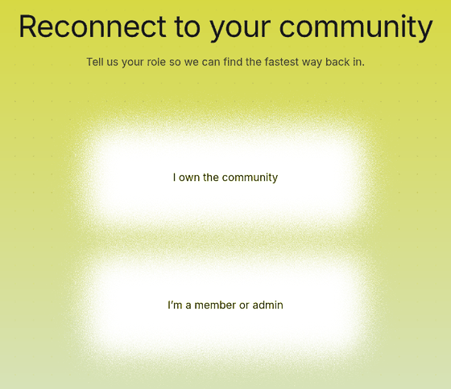
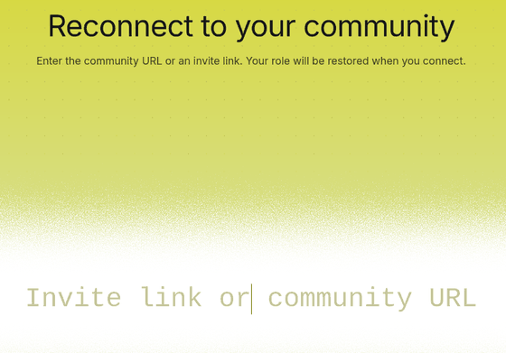
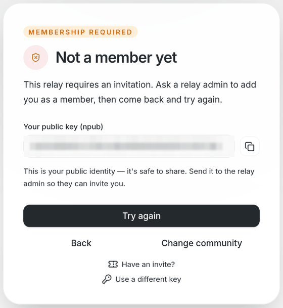

# Buzz

[Buzz](https://github.com/block/buzz) is a Nostr-based messaging platform for human–agent
collaboration: one relay binary serving WebSocket + REST + web UI, backed by PostgreSQL, Redis and
S3-compatible object storage.

This wrapper runs the upstream chart in its production profile and supplies the backing services the
KubeAid way: PostgreSQL from the CloudNativePG operator via `kubeaid-addons`, Redis from the Redis
operator, and object storage from an external S3-compatible endpoint.

Upstream's bundled `postgres` and `redis` subcharts are stripped from the vendored copy, so the
evaluation profile is gone and `buzz.postgresql.enabled` / `buzz.redis.enabled` have to stay false.
Re-vendoring with `bin/manage-helm-chart.sh --update-helm-chart buzz` pulls them back in, so the
removal has to be repeated on every chart bump.

## Prerequisites

- `cloudnative-pg` and `redis-operator` installed on the cluster.
- `sealed-secrets` (or another out-of-band secret mechanism) for the two Secrets below.
- An owner Nostr keypair when relay membership is enabled — see [Relay membership](#relay-membership).
- An S3-compatible bucket plus a **dedicated** access key scoped to it — see
  [Credentials](#credentials). The chart does **not** provision either.

## Installation

In order; each step links to the details below.

1. Generate the owner keypair and keep the secret in your password store —
   [Relay membership](#relay-membership).
2. Create the bucket and a dedicated access key limited to it — [Credentials](#credentials).
3. Seal `buzz-pgsql-credentials` and `buzz-secrets` (including the S3 keys) into your
   `kubeaid-config` repo — [Secrets](#secrets).
4. In the cluster's values file, set at least:

   ```yaml
   buzz:
     relayUrl: wss://buzz.example.com
     ownerPubkey: <64-char hex public key>
     relay:
       requireRelayMembership: true
     s3:
       endpoint: https://s3.example.com
       bucket: buzz-media
     ingress:
       className: <your ingress class>
       annotations: {}      # cert-manager / external-dns, per cluster
       tls:
         - hosts: [buzz.example.com]
           secretName: buzz-tls
   ```

5. Sync. The relay log should show, in order, `Postgres connected`, `Database migrations complete`,
   `Relay owner bootstrapped`, `Redis pub/sub connected`, `Media storage connected`, and the
   conformance probe passing. A `CrashLoopBackOff` after `Media storage connected` is object
   storage — see [Object storage](#object-storage).
6. Check the relay answers:

   ```sh
   curl -H 'Accept: application/nostr+json' https://buzz.example.com
   ```

   It returns the relay's NIP-11 document (`"software": "https://github.com/block/buzz"`, its
   `version`, `"auth_required": true`).
7. Sign in to a Buzz app as the owner and admit everyone else — [Connecting clients](#connecting-clients).

## Secrets

Two Secrets have to exist before the first sync. Both are referenced by name only, so seal them and
commit the SealedSecrets to your `kubeaid-config` repo.

### 1. `buzz-pgsql-credentials` — the database owner

CloudNativePG normally invents the owner's password and writes it to `buzz-pgsql-app`. Buzz cannot
consume that, so this chart pins the credentials instead: `global.postgresql.existingSecret` hands
the Secret to CNPG's `initdb`, which makes the password known ahead of time and therefore safe to
embed in `DATABASE_URL` below.

```sh
kubectl create secret generic buzz-pgsql-credentials \
  --namespace buzz \
  --type kubernetes.io/basic-auth \
  --from-literal=username=buzz \
  --from-literal=password='<password>' \
  --dry-run=client -o yaml | kubeseal -o yaml > buzz-pgsql-credentials.yaml
```

Changing the password afterwards does not reset an already-bootstrapped database — `initdb` runs
once. Rotate it in PostgreSQL and in `buzz-secrets` together.

### 2. `buzz-secrets` — the relay environment

The relay reads **every** secret environment variable from this single Secret, and `DATABASE_URL` is
mandatory — a missing key leaves the pod in `CreateContainerConfigError`. The upstream chart can
generate its own Secret, but that path relies on Helm's `lookup` and regenerates on every render, so
it is unusable under ArgoCD.

| Key | Required | Value |
|---|---|---|
| `DATABASE_URL` | yes | `postgres://buzz:<password>@buzz-pgsql-rw:5432/buzz` |
| `REDIS_URL` | at `replicaCount > 1` | `redis://buzz-redis:6379` |
| `BUZZ_S3_ACCESS_KEY` | yes in practice | Access key for the bucket |
| `BUZZ_S3_SECRET_KEY` | yes in practice | Secret key for the bucket |
| `BUZZ_RELAY_PRIVATE_KEY` | in practice yes | 64-char hex relay identity — see below |
| `BUZZ_GIT_HOOK_HMAC_SECRET` | at `replicaCount > 1` | 32+ random characters |

`<password>` is the same one sealed into `buzz-pgsql-credentials`.

`BUZZ_RELAY_PRIVATE_KEY` is optional to the relay but should always be set here. Upstream generates
one on first install, but only into the Secret the chart manages itself; with `existingSecret` set
that Secret is never rendered, so nothing generates the key and **the relay takes a new identity on
every restart**. Seal one and treat it as a backup — changing it changes who the relay is, and
federation peers will not recognise it.

```sh
openssl rand -hex 32    # BUZZ_RELAY_PRIVATE_KEY
openssl rand -hex 24    # BUZZ_GIT_HOOK_HMAC_SECRET
```

```sh
kubectl create secret generic buzz-secrets \
  --namespace buzz \
  --from-literal=DATABASE_URL='postgres://buzz:<password>@buzz-pgsql-rw:5432/buzz' \
  --from-literal=REDIS_URL='redis://buzz-redis:6379' \
  --from-literal=BUZZ_S3_ACCESS_KEY='<access-key>' \
  --from-literal=BUZZ_S3_SECRET_KEY='<secret-key>' \
  --from-literal=BUZZ_RELAY_PRIVATE_KEY='<64-hex>' \
  --dry-run=client -o yaml | kubeseal -o yaml > buzz-secrets.yaml
```

## Object storage

The relay runs an S3 conformance probe at startup and **exits** if the bucket is unreachable or the
credentials are wrong, so readiness never opens. A relay stuck in `CrashLoopBackOff` on a fresh
install is almost always the bucket, not the database.

`buzz.s3.addressingStyle` picks how objects are addressed: `path` (the default,
`<endpoint>/<bucket>/<key>`) for MinIO, RustFS and other endpoints that do not resolve bucket
subdomains, or `virtual` (`<bucket>.<endpoint>/<key>`) for AWS-style providers. `buzz.s3.region` is
the SigV4 signing region and defaults to `us-east-1`; set it when the provider's credential region
differs.

The bucket must not be folded into `buzz.s3.endpoint`; the two are passed separately.

### Credentials

Give the relay its own access key, limited to its bucket. Do not reuse a key that another workload
already holds — a backup tool's key, for example: the relay would then be able to delete those
backups, and that key usually has no rights on the new bucket anyway.

The key needs:

| Action | Resource | Used for |
|---|---|---|
| `s3:ListBucket`, `s3:GetBucketLocation` | `arn:aws:s3:::<bucket>` | listing, startup probe |
| `s3:GetObject`, `s3:PutObject`, `s3:DeleteObject` | `arn:aws:s3:::<bucket>/*` | media and git objects |
| `s3:ListBucketVersions`, `s3:DeleteObjectVersion` | bucket / `<bucket>/*` | community deletion |

A key without access fails the startup conformance probe with
`git conformance probe failed: s3 backend error: Got HTTP 403 … AccessDenied`, right after
`Media storage connected`. That is a permissions problem, not a missing S3 feature. Check the key
outside the cluster before sealing it:

```sh
AWS_ACCESS_KEY_ID=… AWS_SECRET_ACCESS_KEY=… \
  aws --endpoint-url https://s3.example.com s3api head-bucket --bucket buzz-media
```

Buzz has no key-prefix setting: it writes to the bucket root (`_meta/`, `repos/`, `packs/`, media
blobs, …), so it needs a bucket of its own rather than a folder in a shared one.

### Slow object storage

Uploads stream through the relay to the bucket, and the relay's S3 client has a fixed request
timeout. On a slow backend (HDD-backed MinIO or RustFS, for example) lower the concurrency and the
largest upload so requests finish in time:

```yaml
buzz:
  relay:
    extraEnv:
      - name: BUZZ_MEDIA_MAX_CONCURRENT_UPLOADS              # default 8
        value: "4"
      - name: BUZZ_MEDIA_MAX_CONCURRENT_UPLOADS_PER_PUBKEY   # default 2
        value: "1"
      - name: BUZZ_MAX_VIDEO_BYTES                           # default 500 MiB
        value: "104857600"
```

`BUZZ_MAX_FILE_BYTES` (default 100 MiB) caps other files. Remove the overrides once the backend is
fast enough.

### Conformance probe (A3 gate)

Before serving git traffic the relay races `BUZZ_GIT_PROBE_WRITERS` (default **32**) concurrent
compare-and-swap writers against one key, `BUZZ_GIT_PROBE_ROUNDS` (default 3) times, to prove the
backend gives linearizable conditional writes. Git-on-object-storage stores refs as CAS'd pointer
objects, so a backend without that silently loses concurrent pushes — hence the gate is fatal.

Backends that support `If-Match` but throttle under contention — Ceph RGW among them — fail this with
`503 ServiceUnavailable` partway through, which looks like a capability gap but is not. The tell is
*where* it fails: an unsupported `If-Match` fails deterministically in an early phase, whereas
throttling fails intermittently, after earlier phases and the first round have passed.

Narrow the race rather than removing the gate:

```yaml
buzz:
  relay:
    extraEnv:
      - name: BUZZ_GIT_PROBE_WRITERS
        value: "8"
```

`BUZZ_GIT_CONFORMANCE_PROBE: "false"` skips the gate entirely. That is a last resort — the relay has
no retry or backoff for `503`, so a backend that throttles the probe will also throttle real
concurrent pushes, and skipping only moves the failure to runtime.

## Ingress

`buzz.ingress.className` and `buzz.ingress.annotations` are deliberately empty. Helm merges annotation
maps, so a default here would appear on every install and could not be removed downstream — set both
per cluster.

Relay traffic is long-lived WebSockets. On NGINX raise the timeouts, or connections drop after the
60s default:

```yaml
buzz:
  ingress:
    className: nginx
    annotations:
      nginx.ingress.kubernetes.io/proxy-read-timeout: "3600"
      nginx.ingress.kubernetes.io/proxy-send-timeout: "3600"
```

Traefik proxies WebSockets without extra configuration.

## Relay membership

`buzz.relay.requireRelayMembership` is `false` here, which runs an open relay and needs no operator
identity: any Nostr key that completes NIP-42 auth can connect and create channels. A relay reachable
from the internet should set it to `true`, and then `buzz.ownerPubkey` must be set before the first
sync — the chart refuses to render without it.

The owner is the relay's first member and the one who admits everyone else, so the key has to exist
before anyone can join. It is an ordinary Nostr keypair (secp256k1, the same kind every Buzz app
creates for its user); WireGuard or SSH keys are a different kind and do not work. Generate one
offline with the relay image itself:

```sh
docker run --rm --network none --entrypoint buzz-admin ghcr.io/block/buzz:0.3.0 generate-key
```

```text
Public key:  <64 hex>    → buzz.ownerPubkey (public, safe to commit)
Secret key:  <64 hex>    → the operator's password store; never commit it
```

Alternatively, create the identity in the Buzz mobile app and convert its `npub1…` to hex with
`nak decode`.

`npub1…` and `nsec1…` are not hashes: they are the same 32-byte keys as the hex above, written in
NIP-19 bech32 form with a checksum. The Buzz apps import the secret only as `nsec1…`, so convert the
hex secret once, offline, and keep both forms in the password store:

```sh
nak encode nsec <64-char hex secret>
```

Only this key is created by hand. Every other user's app generates its own keypair on first launch,
and the owner admits them through the app's membership flow or with
`buzz-admin add-member <pubkey>` in the relay pod.

## Connecting clients

Use the Buzz desktop app ([block/buzz-app](https://github.com/block/buzz-app) releases) or the Buzz
mobile app. Opening `https://buzz.example.com/` in a browser shows the relay's NIP-11 JSON document;
that is expected. The relay serves no chat UI, and buzz-app's web build is a development tool that
signs through a local helper, so there is no hosted web client to deploy.

First launch of the desktop app, signing in as the owner:

1. On **Join or create a community**, choose **I already have a community**. **Create a
   community** is for communities that Block's Builderlab hosts and asks for a Builderlab account.

   

2. Choose **I'm a member or admin**. **I own the community** is again the Builderlab-hosted path,
   even for the relay's owner.

   

3. Enter `wss://buzz.example.com`.

   

4. The app creates a key of its own during setup, so a members-only relay answers
   **Not a member yet** and shows that key's npub. That is the relay working: the key is unknown.
   Choose **Use a different key**, paste the owner's `nsec1…`, check that the npub shown is now the
   owner's, and choose **Try again**.

   

Everyone else joins with **Join a community** and an invite link, or sends the owner the npub their
app shows on **Not a member yet** to be added.

## Scaling

## Scaling

`replicaCount > 1` requires `REDIS_URL` and `BUZZ_GIT_HOOK_HMAC_SECRET` in `buzz-secrets`; the chart
fails rendering otherwise. Git state lives in object storage, so `ReadWriteOnce` volumes stay correct
at any replica count — no ReadWriteMany storage is needed.

## Relay image

`image.tag` is pinned to `0.3.0`, the vendored chart's `appVersion`, rather than inherited from it, so
a chart bump never moves the relay by itself. `0.3.0` is also the first relay with NIP-FI, the
federated-identity layer that OIDC single sign-on is built on; `0.2.0` predates it.

Relays before `0.2.0` predate the startup migration step: they never create the schema,
`_sqlx_migrations` is never written, and the relay then serves traffic while every query fails on a
missing relation — it looks healthy and answers WebSockets, so the cause is not obvious.

A relay that runs migrations logs either `Database migrations complete` or `Skipping database
migrations because BUZZ_AUTO_MIGRATE is not enabled` right after `Postgres connected`. Neither line
means the image is too old, whatever `BUZZ_AUTO_MIGRATE` is set to.

Re-check the pin when bumping the chart, and read upstream's upgrade notes first: some relay
releases require every pod to run a specific stop build before their migrations run.

Verify any new tag actually exists before pinning it. GHCR's `tags/list` for this repository returns
incomplete and inconsistent pages, and upstream's GitHub releases run ahead of the published relay
images — `v0.5.2` is tagged in git with no image behind it. Ask the registry about a specific tag
instead:

```sh
crane manifest ghcr.io/block/buzz:<tag> >/dev/null && echo exists
```

Relay release tags are `relay-v<version>` in git and `<version>` on GHCR; the `v0.5.x` and
`desktop-v*` tags are desktop app releases with no relay image behind them.

## Init containers

`buzz.extraInitContainers` ships two, both `postgres:16-alpine`:

- **`wait-for-db`** — CNPG is usually still bootstrapping when the relay first rolls out, and the
  relay exits rather than retries. It polls with `psql` rather than `pg_isready` so it proves auth
  and the database, not just an open socket.
- **`reconcile-legacy-schema`** — repairs installs that passed through relay 0.1.0. That image
  created `audit_log` at runtime but shipped no migration runner, so sqlx recorded nothing; migration
  1 then aborts on `relation "audit_log" already exists` and rolls the whole schema back. The result
  is a relay that starts, serves WebSockets and fails every query on a missing relation. It is
  guarded on `_sqlx_migrations` being absent, so it is a no-op on a fresh install and after the first
  successful migrate, and can be dropped once no install predates 0.2.0.

Both assume the chart defaults — host `buzz-pgsql-rw` from `global.postgresql.instanceName`, and the
`DATABASE_URL` key from `secrets.existingSecret`. Change either and change these to match.
`extraInitContainers` is a list, so overriding it downstream replaces rather than merges.

## Git storage

`persistence.git.enabled` is `false`, so git working space is an emptyDir. That is deliberate.

The upstream Deployment hardcodes `strategy.rollingUpdate.maxUnavailable: 0` and exposes no value to
change it, so a rollout requires the replacement pod to be running before the old one exits. A
ReadWriteOnce volume — which is what most block storage classes give you, rook-ceph-block included —
cannot attach to two nodes at once, so **every rollout deadlocks on `Multi-Attach`** and the
Deployment never converges.

Nothing durable is lost. Git objects are rehydrated from object storage on each request and
repo-name uniqueness lives in Postgres, which is why upstream dropped its ReadWriteMany requirement.
The only cost is a cold cache after a restart.

Enable the PVC only with a ReadWriteMany storage class, where both pods can hold the volume during a
rollout.

## Backups

Losing any of these is data loss: `BUZZ_RELAY_PRIVATE_KEY`, the PostgreSQL database, and the S3
bucket. Enable `global.postgresql.backups` / `logicalbackup` for the database. Git state lives in the
bucket, not on disk, so the relay's local storage needs no backup.
